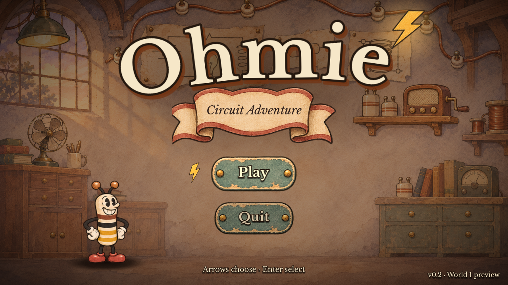
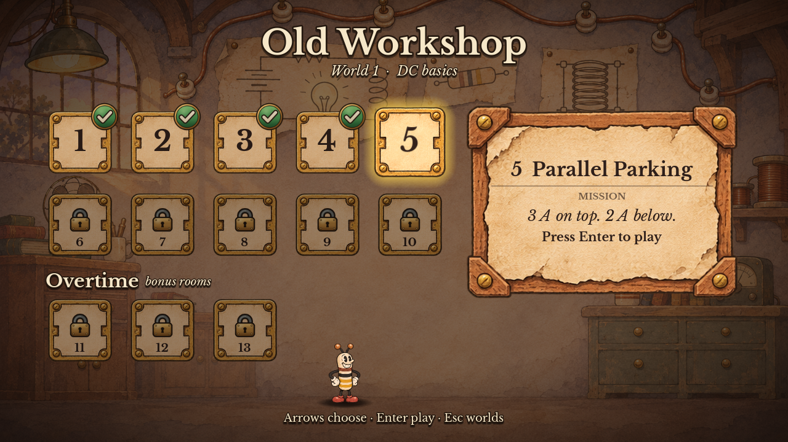
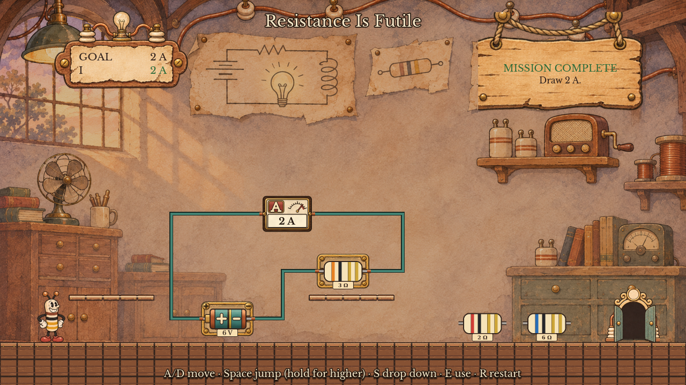
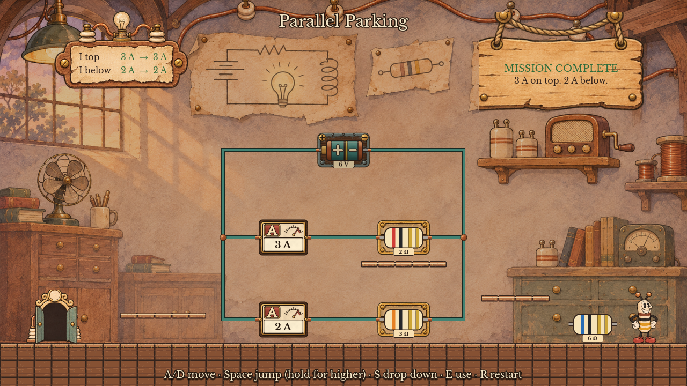
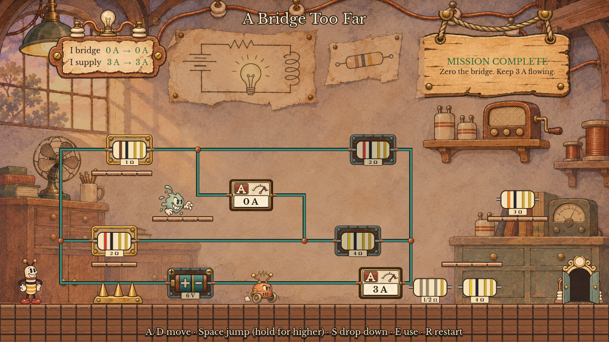

# Ohmie: Circuit Adventure

A 2D puzzle platformer where every room is a real electric circuit. Built with Godot 4.7.



Ohmie is a small striped resistor with legs, loose in an old electrical workshop. Each room has an unfinished circuit wired across the wall, a handful of batteries and resistors lying around, and a locked door. Carry the parts to the circuit's slots, one at a time, until the circuit does what the mission asks. Then the door opens.

The missions are short, like the notes an engineer would leave on a bench:

- *Light the lamp.*
- *Draw 2 A.*
- *Make 6 Ω.*
- *Put 9 V on the meter.*
- *3 A on top. 2 A below.*
- *Zero the bridge. Keep 3 A flowing.*

How you get there is up to you.

## What makes it different

- **The circuits are real.** The game solves the whole network exactly, every voltage, current and power, each time you plug something in. Nothing is scripted per room, so any arrangement that satisfies the mission wins. Most rooms have more than one answer.
- **Every slot takes any part.** Batteries and resistors are both things you carry. Put a battery where a resistor should go and you get what physics gives you: usually nothing, sometimes a short circuit.
- **Meters tell you the truth.** Ammeters, voltmeters and ohmmeters sit on the board and show live readings as you build. Lamps light, stay dark, or blow.
- **Exact numbers.** Readings are fractions, never rounded. 6 V across 4 Ω is 3/2 A.
- **Platforming chooses the circuit.** The whole circuit is always on screen, but the parts are not all easy to reach. The resistor lying at your feet is often the wrong one.
- **Decoys.** Rooms hold more parts than they need, and some of them are there to tempt you.

## World 1: the Old Workshop

The first world covers basic DC circuits in ten rooms, plus three harder overtime rooms.

| # | Room | Mission | Idea |
|---|---|---|---|
| 1 | Closing Time | Light the lamp. | Close a loop |
| 2 | Resistance Is Futile | Draw 2 A. | Ohm's law: pick the resistor |
| 3 | Ohm Sweet Ohm | Draw 3 A. | Pick the source too |
| 4 | Chain Gang | Make 6 Ω. | Series resistors add |
| 5 | Parallel Parking | 3 A on top. 2 A below. | Parallel branches |
| 6 | Divide and Conquer | Put 2 V on the meter. | Voltage divider |
| 7 | Half and Half | Make 1 Ω. | Series and parallel together |
| 8 | Assault and Battery | Put 9 V on the meter. | Series sources add |
| 9 | Light Duty | Light the lamp. Don't blow it. | A safe operating range |
| 10 | Ohm Stretch | Draw 2 A. Put 4 V on the meter. | Two conditions at once |
| 11 | Watt's Up | Burn 12 W in the heater. | Power |
| 12 | A Bridge Too Far | Zero the bridge. Keep 3 A flowing. | A balanced Wheatstone bridge |
| 13 | Loop Hole | Put 4 V on the meter. | Two sources, two loops |

Four more worlds are planned (Copper Foundry, Substation Switchyard, Signal Clocktower, High-Voltage Transmitter). The aim is a full electronics game: each world adds new families of parts, such as diodes and LEDs, capacitors, switches and logic gates, on the same engine.

## Screenshots

Choosing a room. Rooms unlock in order, and progress is saved.



"Resistance Is Futile", solved. The 6 V battery and the 3 Ω resistor drive exactly 2 A through the ammeter, the wires light up and the door opens.



"Parallel Parking". Each branch has its own ammeter, so which resistor goes in which branch matters.



"A Bridge Too Far". The right pair of resistors balances the bridge: the middle ammeter reads 0 A while 3 A flows from the supply.



## Controls

| Action | Keys |
|---|---|
| Move | A / D or arrow keys |
| Jump | Space, W or Up (hold for a full jump) |
| Drop through a platform | S or Down |
| Pick up, plug in, pull out, swap | E |
| Restart the room | R |
| Back to the map | Esc |
| Menus | Arrow keys or mouse, Enter to confirm, Esc to go back |

Ohmie carries one part at a time and has to be standing to use it.

## Running it

1. Install [Godot 4.7](https://godotengine.org/download) (standard build).
2. Clone this repository.
3. Open `project.godot` in Godot and press F5, or run `godot --path .` from the project folder.

## Status

In development. World 1 is playable from the title screen through all thirteen rooms. The overtime rooms add bounce pads, patrolling enemies and hazards. Planned next: a step-by-step replay showing how each solved network simplifies, then World 2.

## For developers

Run the tests:

```
godot --headless --path . --script res://tests/run_tests.gd
godot --headless --path . --fixed-fps 60 --script res://tests/play_w1_02.gd
```

The first runs the unit tests for the circuit engine and level loading. The second plays a room start to finish with scripted input; there is one such test per room (`tests/play_w1_NN.gd`).

Check that a room is solvable and list every solution:

```
godot --headless --path . --script res://tools/validate_level.gd -- res://levels/w1_10.json
```

| Folder | Contents |
|---|---|
| `assets/` | Art and audio (hand-inked cartoon pack, five worlds) |
| `src/circuit/` | Circuit engine: exact fractions, DC network solver, goal conditions, puzzle search |
| `src/level/`, `src/objects/`, `src/player/`, `src/ui/` | Rooms, board parts, Ohmie, HUD and menus |
| `levels/` | One JSON file per room, and `campaign.json` for the order |
| `tests/` | Unit tests and scripted playthroughs |
| `tools/` | Level validator, art generators, screenshot tools |
| `docs/` | Game design document, asset notes, decision log |
