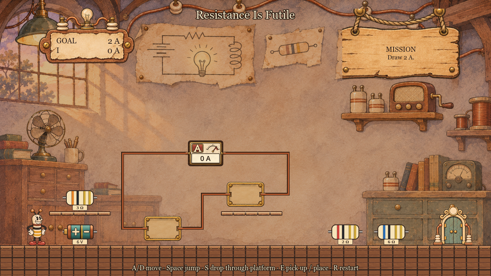
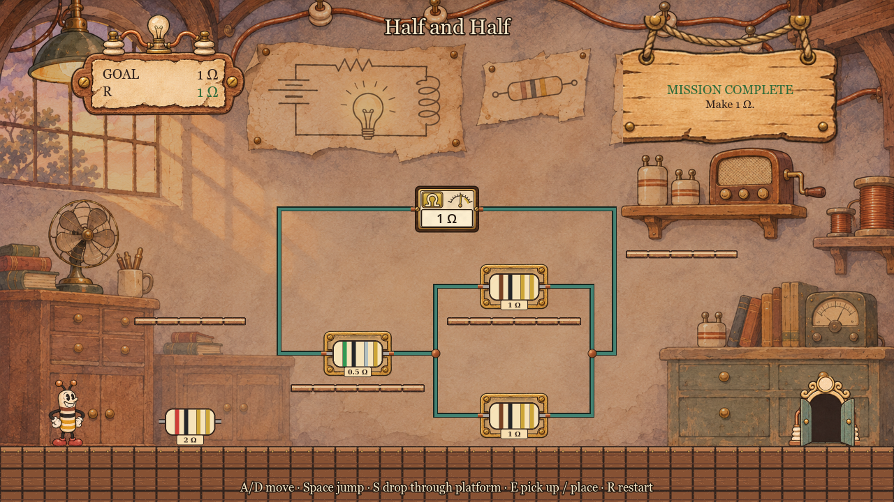

# Ohmie: Circuit Works

A 2D platformer where the puzzle is a resistor network. Built with Godot 4.7.

Ohmie is a small robot in a copper factory. Every room has a half-built circuit on the wall and a locked door. Carry resistors to the circuit's sockets, one at a time, until the equivalent resistance is **exactly 1 Ω**. Then the door opens.

- **Every room has a mission.** For now the mission is an exact resistance. Later worlds add voltage sources, LEDs and logic gates, each with its own kind of goal.
- **The whole circuit is always on screen.** Every level is one room.
- **Platforming chooses the circuit.** Where a resistor lies and how hard a socket is to reach decide which solution is practical.
- **Exact math.** Values are fractions, never rounded. 1/3 + 2/3 is 1.
- **Learn by watching.** After each solve, the network collapses step by step into a single resistor.

## Status

Early development, but playable. Milestone 1 (a one-room vertical slice) works end to end: run and jump, carry resistors, plug them into sockets, watch the exact live readout, and walk through the door when the circuit reads exactly 1 Ω. See the milestone plan in [docs/GDD.md](docs/GDD.md).

## Screenshots

The first room, "Resistance Is Futile". The board is one closed loop: two empty slots and an ammeter. A 6 V battery and three resistors lie around the room; the mission is to draw exactly 2 A.



Solved: the battery in one slot and the 3 Ω resistor in the other drive exactly 2 A, the wires light up and the door opens.


"Half and Half": an ohmmeter closes a board of one slot in series with two in parallel. 1/2 Ω plus two 1 Ω in parallel reads exactly 1 Ω.



## Controls

| Action | Keys |
|---|---|
| Move | A / D or arrow keys |
| Jump | Space, W or Up |
| Drop through a platform | S or Down |
| Pick up, plug in, pull out, swap; next room after a win | E |
| Restart the room | R |

## Running it

1. Install [Godot 4.7](https://godotengine.org/download) (standard build).
2. Clone this repository.
3. Open `project.godot` in Godot and press F5, or run `godot --path .` from the project folder.

Run the tests:

```
godot --headless --path . --script res://tests/run_tests.gd
godot --headless --path . --fixed-fps 60 --script res://tests/play_w1_02.gd
```

The first runs the unit tests for the circuit math and level loading. The second plays the first room start to finish with scripted input.

## Project layout

| Folder | Contents |
|---|---|
| `assets/` | Art, audio and data (hand-inked cartoon pack, five worlds) |
| `src/circuit/` | Circuit math: exact rationals, network solver, puzzle solver |
| `src/` | Player, level, objects and UI code |
| `levels/` | Level data, one JSON file per room |
| `tests/` | Headless tests |
| `docs/` | Game design document, asset audit, decision log |
